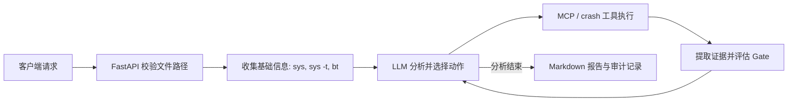

# VMCore Analysis Agent

[English](./README.md) | 简体中文

基于 LangGraph、MCP 和 Linux `crash` 工具的 vmcore 分析服务。项目入口位于 [`vmcore-analysis-agent/`](./vmcore-analysis-agent/)；本 README 介绍该组件的工作流程、部署方式和输出。

## 项目能做什么

服务接收 vmcore、匹配的 `vmlinux`、`vmcore-dmesg.txt` 以及可选的模块调试符号，驱动 Agent 循环执行 `crash` 命令并生成 Markdown 分析报告。分析结果用于辅助定位，仍需结合内核版本、符号文件和现场信息由工程师复核。

主要能力：

- 先收集崩溃基础信息，再根据当前分析状态选择后续诊断动作。
- 通过 MCP 调用 `crash` 等工具，并对命令执行进行保护和去重。
- 使用假设与验证门控跟踪证据；是否关闭门控由执行器根据工具输出判断，而非直接采信模型给出的状态。
- 提供同步和 SSE 流式 API；报告正文之外可生成单独的 Gate 审计文件。

## 工作流程



一次分析大致经过以下步骤：

1. FastAPI 检查请求中的文件路径，并创建 Agent 初始状态。
2. LangGraph 执行初始 `crash` 命令，收集系统、taint 和堆栈信息。
3. LLM 根据当前上下文选择下一步分析或工具调用；`action_guard` 和执行器负责约束、执行工具动作。
4. 证据评估器从工具输出提取事实并更新 Gate。必需 Gate 尚未达到 `closed` 或 `n/a` 时，分析不能标记为已确定。
5. 服务返回分析结果；客户端默认保存 Markdown 报告，并在存在 Gate 数据时保存配套的 `.audit.md`。

### 核心目录

| 路径 | 职责 |
|---|---|
| [`main.py`](./vmcore-analysis-agent/main.py) | FastAPI 服务、分析 API 与生命周期初始化 |
| [`client/`](./vmcore-analysis-agent/client/) | HTTP/SSE 客户端及命令行入口 |
| [`src/react/`](./vmcore-analysis-agent/src/react/) | LangGraph 节点、路由、状态、Prompt、证据评估和报告生成 |
| [`src/llm/`](./vmcore-analysis-agent/src/llm/) | LLM 客户端创建 |
| [`src/mcp_tools/`](./vmcore-analysis-agent/src/mcp_tools/) | MCP 工具注册及 crash、源码补丁等工具 |
| [`tests/`](./vmcore-analysis-agent/tests/) | 单元和集成测试 |
| [`doc/`](./vmcore-analysis-agent/doc/) | 架构流程图等项目文档 |
| [`reports/`](./vmcore-analysis-agent/reports/) | 本地生成的报告目录 |

## 部署前准备

服务运行在能够访问 vmcore 文件的 Linux 主机上。准备以下环境和输入：

- Python 3.11 或更高版本，以及 [`uv`](https://docs.astral.sh/uv/)。
- Linux `crash` 工具，以及与 vmcore 内核版本匹配的 `vmlinux` 调试符号。
- 与该 vmcore 对应的 `vmcore-dmesg.txt`。
- 可选：需要分析的第三方内核模块调试符号（`.ko`）。
- 可访问的 OpenAI 兼容模型服务及 API Key。

仓库提供的 mpykdump 安装脚本面向 x86_64，并随附 crash 8.0/9.0 对应扩展。其他 crash 版本需自行准备兼容扩展。

## 快速开始

以下命令以 Linux shell 为例。

### 1. 安装依赖

在仓库根目录执行：

```bash
cd vmcore-analysis-agent
uv sync
```

如果需要安装仓库提供的 mpykdump 扩展，在 `vmcore-analysis-agent` 目录执行（脚本会向系统 crash 扩展目录写文件，可能需要 `sudo`）：

```bash
bash tools/install_mpykdump.sh
```

### 2. 配置模型

复制配置模板：

```bash
cp .env.example .env
```

编辑 `vmcore-analysis-agent/.env`，填入模型服务的有效凭据和地址：

```dotenv
REASONING_API_KEY=替换为你的API密钥
REASONING_BASE_URL=https://token-plan.cn-beijing.maas.aliyuncs.com/compatible-mode/v1
REASONING_MODEL=deepseek-v4.1-flash-1017

REASONING_THINKING=enabled
REASONING_EFFORT=max
REASONING_TEMPERATURE=0.1
REASONING_CONTEXT_WINDOW=524288
REASONING_MAX_OUTPUT_TOKENS=48000
REASONING_MIN_THINKING_OUTPUT_TOKENS=40960
REASONING_HISTORY_KEEP=2
LANGSMITH_TRACING=false
```

| 变量 | 必需 | 说明 |
|---|---:|---|
| `REASONING_API_KEY` | 是 | 模型服务 API Key |
| `REASONING_BASE_URL` | 是 | 模型服务的 OpenAI 兼容 API 地址 |
| `REASONING_MODEL` | 是 | 服务端使用的模型名称 |
| `REASONING_THINKING` | 否 | `enabled` 或 `disabled`，默认 `disabled` |
| `REASONING_EFFORT` | 否 | 推理强度，默认 `max` |
| `REASONING_TEMPERATURE` | 否 | 采样温度，默认 `0.1` |
| `REASONING_CONTEXT_WINDOW` | 否 | 上下文预算，默认 `524288`；应按模型服务商的实际限制设置 |
| `REASONING_MAX_OUTPUT_TOKENS` | 否 | 最大 completion 预算，默认 `48000` |
| `REASONING_MIN_THINKING_OUTPUT_TOKENS` | 否 | 保持 thinking 模式所需的最低输出预算，默认 `40960` |
| `REASONING_HISTORY_KEEP` | 否 | 压缩时保留的历史 reasoning 数量，默认 `2` |
| `LANGSMITH_TRACING` | 否 | 是否启用 LangSmith 追踪，默认 `false` |

进程环境变量优先于 `.env`。缺少三个必需模型变量或配置值无效时，服务会在启动阶段报错。不要提交含真实密钥的 `.env` 文件。MCP 工具由代码自动发现，不需要在 `.env` 中填写 MCP 服务路径。

### 3. 启动服务

在 `vmcore-analysis-agent` 目录执行：

```bash
uv run uvicorn main:app --host 0.0.0.0 --port 8000
```

- 健康检查：<http://localhost:8000/health>
- API 文档：<http://localhost:8000/docs>
- 指标：<http://localhost:8000/metrics>

当前 API 未实现内置身份认证。生产部署时请限制网络访问，或在受控的反向代理/API 网关后提供服务。

### 4. 调用分析

客户端应能访问服务端，且请求中的文件路径必须是**服务端可访问的路径**（客户端不会上传 vmcore 文件）。

```bash
cd client
uv run main.py --health --url http://localhost:8000

uv run main.py --url http://localhost:8000 --stream \
  --vmcore-path /data/case/vmcore \
  --vmlinux-path /usr/lib/debug/lib/modules/<kernel-version>/vmlinux \
  --vmcore-dmesg-path /data/case/vmcore-dmesg.txt \
  --debug-symbols /data/case/driver.ko \
  --output-dir ../reports
```

主要参数：

| 参数 | 说明 |
|---|---|
| `--url` | API 服务地址，默认 `http://localhost:8000` |
| `--health` | 只检查服务健康状态 |
| `--stream` | 使用 SSE 流式接口；不指定时使用同步接口 |
| `--vmcore-path` | vmcore 路径 |
| `--vmlinux-path` | 匹配的 `vmlinux` 路径 |
| `--vmcore-dmesg-path` | `vmcore-dmesg.txt` 路径 |
| `--debug-symbols` | 可选的模块调试符号路径，可提供多个 |
| `--timeout` | 请求超时秒数，默认 `600` |
| `--output-dir` | 报告输出目录，默认 `../reports`（相对于 `client` 当前目录） |
| `--no-save` | 不保存报告文件 |

## API 与输出

### API

| 方法 | 路径 | 用途 |
|---|---|---|
| `GET` | `/health` | 返回服务、LLM 和工具初始化状态 |
| `POST` | `/analyze` | 同步分析 |
| `POST` | `/analyze/stream` | 通过 Server-Sent Events 返回进度和结果 |

两个分析接口使用相同的 JSON 请求字段：

```json
{
  "vmcore_path": "/data/case/vmcore",
  "vmlinux_path": "/data/case/vmlinux",
  "vmcore_dmesg_path": "/data/case/vmcore-dmesg.txt",
  "debug_symbol_paths": ["/data/case/driver.ko"]
}
```

前三个字段必需；`debug_symbol_paths` 可省略或传空数组。文件路径由服务端检查。同步响应包含 `success`、`task_id`、`agent_answer`、`token_usage`，以及可选的 `error`、`audit_report`。流式接口以 SSE 事件发送进度，完成事件包含分析结果和审计内容。

### 报告文件

服务当前默认生成英文报告。客户端默认保存分析 Markdown 报告；如果结果中包含 Gate 数据，还会保存同名的 `.audit.md` 文件。`--no-save` 会跳过这两个文件的保存。审计文件记录 Gate 状态、证据和状态转换，适合追溯；常规阅读优先查看主报告中的验证状态摘要。

## 诊断状态与 Gate

`CrashSignatureClass` 表示从崩溃现场初步识别出的签名，用于选择诊断路径；`RootCauseClass` 表示调查后确认的根因类别。两者不是同一层级的分类。

Gate 是分析状态机中的验证检查点。Gate 是否关闭由执行器根据工具输出中的结构化证据评估，模型给出的状态只是建议。当前签名要求的 Gate 尚未全部达到终态时，分析不会被标记为确定。

| 状态 | 含义 |
|---|---|
| `open` | 尚未完成验证 |
| `blocked` | 前置 Gate 未满足，当前检查暂不能完成 |
| `closed` | 已满足相应证据条件 |
| `n/a` | 已确认该检查不适用，需有理由 |

常见检查：

- `register_provenance`：追溯故障寄存器中的值来自哪个指令、对象或字段。
- `object_lifetime`：评估转储中对象/内存槽位的当前状态。比如 `kmem -S` 显示 `[ALLOCATED]` 只能说明转储时槽位已分配，不能据此排除对象曾释放后被复用。
- `local_corruption_exclusion`：结合反汇编和内存观测，检查本地代码是否可能写入异常值。

具体必需 Gate 和完成条件由 [`schema.py`](./vmcore-analysis-agent/src/react/schema.py) 与 [`evidence.py`](./vmcore-analysis-agent/src/react/evidence.py) 定义。

## 项目结构

```text
ai-app-hub/                       # 仓库根目录（包含多个项目）
├── README.md
├── README.zh-CN.md
└── vmcore-analysis-agent/         # 本文档介绍的组件
    ├── main.py                   # FastAPI 入口
    ├── client/                   # CLI 与 HTTP/SSE 客户端
    ├── src/
    │   ├── llm/                  # 模型初始化
    │   ├── react/                # Agent 图、Prompt、状态、证据和报告
    │   ├── mcp_tools/            # MCP 工具
    │   └── utils/                # 设置与日志
    ├── tests/                    # 测试
    ├── tools/                    # 运维和调试辅助脚本
    ├── doc/                      # 流程图等文档
    ├── simulate-crash/           # 崩溃复现场景
    ├── reports/                  # 报告输出目录
    ├── pyproject.toml
    ├── uv.lock
    └── .env.example
```

## 常见问题

- **服务启动提示缺少配置**：检查 `vmcore-analysis-agent/.env` 或进程环境中是否设置了 `REASONING_API_KEY`、`REASONING_BASE_URL`、`REASONING_MODEL`。
- **文件不存在**：传给 API 的路径在服务端解析，不是运行 CLI 的客户端本地路径。
- **crash 命令或扩展不可用**：确认服务主机已安装 `crash`，符号文件与 vmcore 对应；仓库脚本只适用于 x86_64 的 crash 8.0/9.0。
- **模块缺少源码/符号信息**：为对应内核和模块准备匹配的调试符号；可参考下方附录。
- **API 长时间无响应**：尝试 `--stream` 查看进度，并根据分析耗时调整客户端 `--timeout`。

## 附录：第三方驱动调试符号编译指南（以 mlx5_core 为例）

在分析涉及第三方驱动（如 Mellanox 网卡驱动）的 vmcore 时，如果默认驱动缺少调试符号，需要手动安装源码并重新编译。以下是标准操作流程：

### 1. 环境准备

安装驱动源码包和对应的内核开发包：

```bash
# 安装 Mellanox 驱动源码
rpm -ivh mlnx-ofa_kernel-source-5.8-OFED.5.8.3.0.7.1.rhel8u4.x86_64.rpm

# 安装对应版本的内核开发包（需与 vmcore 的内核版本一致）
rpm -ivh --oldpackage kernel-devel-4.18.0-305.130.1.el8.x86_64.rpm
```

### 2. 编译带调试信息的模块

进入源码目录并配置编译选项：

```bash
cd /usr/src/ofa_kernel-5.8/source

# 配置编译选项：开启 debug info，指定内核源码路径
./configure --with-debug-info --with-mlx5-mod \
                 --kernel-sources /usr/src/kernels/4.18.0-305.130.1.el8_4.x86_64 \
                 --cache-file=my_config.cache

# 执行编译
make -j$(nproc)
```

### 3. 验证调试符号

编译完成后，通过以下方式验证模块是否包含调试信息：

```bash
# 1. 检查 debug section 是否存在
readelf -S drivers/net/ethernet/mellanox/mlx5/core/mlx5_core.ko | grep debug

# 2. 尝试反汇编导出源码（验证源码关联）
objdump -S -d drivers/net/ethernet/mellanox/mlx5/core/mlx5_core.ko > mlx5_debug.asm

# 3. 使用工具脚本验证符号解析
# 从仓库根目录执行
cd /path/to/ai-app-hub
bash vmcore-analysis-agent/tools/show_first_global_func.sh /usr/src/ofa_kernel-5.8/source/drivers/net/ethernet/mellanox/mlx5/core/mlx5_core.ko
```

## 贡献与许可

欢迎提交 Issue 和 Pull Request。项目原有文档声明采用 MIT License；发布时请确保发行包包含对应的许可证文本。
